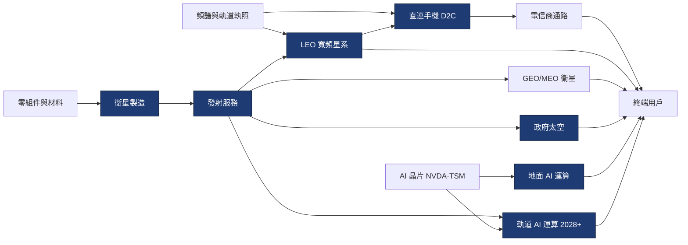

> 大部分人談 SpaceX，談的是火箭：會降落、會回收、很酷。
> 稍微懂一點的人會說：真正賺錢的是 Starlink，火箭只是送貨卡車。
> 但 2026 年的 SpaceX 財報顯示，營收最大的部門已經不是火箭，也不是 Starlink，而是出租 AI 算力。
> 想看懂這家兩兆美元的公司，得先看懂整條太空產業鏈：瓶頸卡在哪裡，利潤又落在哪一層。

---

> ⚠️ **免責聲明**：本文為教育性分析與閱讀筆記，數字引用自公開申報文件，**不構成任何投資建議或買賣訊號**。投資決策請自行判斷並諮詢專業意見。股價與估值以 **2026-10-23 收盤（$147.49）** 計。
>
> **利益揭露**：本系列的 InvestSkill 分析由 Claude（Anthropic 開發的 AI）在本機執行，文章也由 Claude 協助撰寫。SpaceX 的公開說明書揭露，Anthropic 是 SpaceX 的雲端算力客戶（詳見 part 2），請讀者自行評估這層關係。

---

## 系列導覽

這個系列分五篇，每篇都**在本機實際跑一次** [InvestSkill](https://github.com/yennanliu/InvestSkill) 的分析技能，把終端機輸出截圖放進文章，再用自己的話解讀。

| 篇 | 主題 | 使用的技能 |
|---|---|---|
| **part 1（本篇）** | 太空產業全景：價值鏈、瓶頸與利潤池 | `industry-map` |
| part 2 | 拆解財報：三個事業、一張合併報表 | `financial-report-analyst`、`fact-check` |
| part 3 | 護城河與競爭者：發射、寬頻、AI 各打一場仗 | `competitor-analysis` |
| part 4 | 估值：兩兆美元要怎麼算才合理 | `stock-valuation` |
| part 5 | 空方論點、催化劑與結論 | `bear-case`、`catalyst-calendar` |

---

## 一、為什麼現在要看 SpaceX

2026 年 6 月 12 日，Space Exploration Technologies Corp. 以每股 **$135** 在 Nasdaq 掛牌，代號 **SPCX**。這次 IPO 發行約 5.56 億股新股，加上超額配售，公司從 IPO 拿到約 **$857 億** 現金（10-Q 現金流量表）。這是美股史上規模最大的 IPO 之一。

上市後股價波動很大：

```
SPCX 收盤價（US$，Yahoo Finance 日線，2026-06-12 ~ 2026-10-23）
IPO 定價       $135.00
上市首日       $160.95  ← +19%
高點 06-16     $211.39  ← 上市第三個交易日
低點 08-05     $108.27  ← 跌破 IPO 價 20%
10-23 收盤     $147.49  ← 比 IPO 價高 9%，比高點低 30%
```

用 2026-10-15 的流通股數（Class A 82.47 億股＋Class B 53.35 億股＝**135.81 億股**）計算，市值約 **$2.0 兆**。

這家公司其實是三個事業疊在一起，而且三個事業的成熟度差很多：

| 部門 | 做什麼 | FY2025 營收 | Q3 2026 營收 | Q3 營業利益率 |
|---|---|---|---|---|
| **Space** | Falcon 9／Heavy 發射、Dragon 載人與貨運、Starship 開發 | $4,086M | $1,767M | −0.4% |
| **Connectivity** | Starlink 衛星寬頻、Starlink Mobile（直連手機）、Starshield | $11,387M | $5,248M | **45.1%** |
| **SI**（原 AI 部門） | Grok 模型、X 社群平台、Cursor、GPU 雲端算力出租 | $3,201M | $7,560M | 5.7% |

來源：424B4 公開說明書 MD&A；Q3 2026 10-Q Note 18。營業利益率為本文計算。

下面兩張圖可以看出，營收結構在短短九個月內整個翻轉：

```
FY2025 營收組成（US$ M，合計 18,674）
Space     ████████████                        4,086   21.9%
Connect.  ██████████████████████████████████  11,387  61.0%
AI        ██████████                          3,201   17.1%

Q3 2026 營收組成（US$ M，合計 14,575）
Space     ████████                            1,767   12.1%
Connect.  ████████████████████████            5,248   36.0%
SI        ██████████████████████████████████  7,560   51.9%
```

2025 年，SpaceX 基本上還是「Starlink 公司」。到 2026 年第三季，一半以上的營收已經來自 AI 部門，主要是把 GPU 算力租給外部客戶。所以這篇不能只講火箭。要評估 SpaceX，得同時看懂三條產業鏈：**發射、衛星通訊、AI 算力**。

---

## 二、怎麼做的：在本機跑 InvestSkill

### 步驟 0：取得財報

SpaceX 上市才四個多月，**還沒有任何一份 10-K 年報**。可用的一手資料只有兩份：

1. **424B4 最終公開說明書**（2026-06-12）：含 FY2023–FY2025 經查核財報、2026 Q1 財報，以及完整的業務說明與風險因子。
2. **Q3 2026 10-Q**（2026-10-22 申報，季底 2026-09-30）：最新一季財報。

這兩份都用 InvestSkill 內建的 `fetch:edgar` 從 SEC EDGAR 直接下載：


*公開說明書存成 1,455 KB 的純文字檔，10-Q 則是 205 KB。最後一行的 `fetch:fundamentals` **失敗了**：這支腳本從 XBRL 抓「最近一個完整會計年度」，但 SpaceX 還沒申報年報，所以沒有年度資料可以抓。*

這個失敗本身就是一個值得記下的事實：**新上市公司的資料是不完整的**。我的處理方式是依照 InvestSkill 資料包（data pack）的格式，手動從兩份申報文件抄出數字，整理成 `data/fixtures/SPCX.md`。凡是 TTM（近四季）數字，一律用「FY2025 − 9M2025 + 9M2026」手算，並在文中標明為計算值。

### 步驟 1：跑分析技能

每個技能都用 `claude -p` 在本機無人值守地執行，載入的是 InvestSkill repo 裡最新的 plugin。提示詞限定只能讀這三個檔案，需要競爭對手資料的技能才另外開放網路搜尋。

| 技能 | 用在 | 執行時間 | 訊號 |
|---|---|---|---|
| `industry-map` | part 1 | 3.5 分鐘 | BULLISH 6.3／HOLD |
| `financial-report-analyst` | part 2 | 4.5 分鐘 | NEUTRAL 4.5／HOLD |
| `competitor-analysis` | part 3 | 3.3 分鐘 | BULLISH 6.6／HOLD |
| `bear-case` | part 5 | 2.6 分鐘 | BEARISH 3.0／SELL |
| `catalyst-calendar` | part 5 | 3.9 分鐘 | NEUTRAL 4.5／HOLD |

（`stock-valuation` 與 `fact-check` 的結果放在 part 2 與 part 4。）

這篇用的是 `industry-map`：它把一個產業畫成上游到下游的有向圖，標出目標公司的位置、各環節的瓶頸分數，以及利潤往哪裡移動。


*第一行是實際下的指令。技能的三點摘要已經點出這篇的主軸：發射是瓶頸，但利潤落在 Starlink；下一波利潤可能流向頻譜與 AI 算力。*

---

## 三、太空產業的價值鏈長什麼樣子

先建立一個直覺：**太空產業就是「把東西送上天，再用天上的東西賺地面的錢」**。

這條鏈可以切成四層。每一層的競爭結構完全不同，所以利潤率也完全不同：

```
上游（投入）          中游（基礎設施）            下游（客戶）

頻譜／軌道執照 ──▶    LEO 寬頻星系 ──────▶        家戶／企業／航空／海事
                           │
                           └─▶ 直連手機 D2C ──▶   電信商 → 手機用戶
零組件／材料 ──▶      衛星製造
                           │
                           ▼
                      發射服務 ◄ 瓶頸 ──────▶     政府：NASA／國防
                           │ （把衛星送上 LEO）
AI 晶片 NVDA/TSM ──▶  AI 資料中心 ─────────▶      AI 雲端客戶
                      （地面 → 2028 軌道）
```

把 SpaceX 放上這張圖，會發現它**同時占了六個節點**：衛星製造、發射、LEO 寬頻、直連手機、政府太空，以及 AI 算力。換成其他產業，這相當於一家公司同時是台積電、物流公司、電信商和雲端業者。

`industry-map` 技能用 Mermaid 畫了更細的版本（深藍色是 SpaceX 已進入或明確規劃進入的節點）：



接下來一層一層看。

---

## 四、發射：可回收火箭為什麼改寫了整個產業

### 直覺

傳統火箭用一次就丟，等於每次飛行都把一架飛機扔進海裡。SpaceX 的核心突破，是讓 Falcon 9 的第一節助推器飛回來降落，修整後再飛。

### 數字

公開說明書引用 NASA 的估算：歷史平均發射成本約 **$18,500／公斤**；第一版 Falcon 9（2010 年）降到約 **$2,700／公斤**，少了約 85%（424B4 Prospectus Summary）。截至 2026-03-31：

- 累計完成約 **650 次**軌道發射，其中 540 次以上用的是飛過的火箭。
- 單一助推器最多重複飛行 **34 次**。
- Falcon 系列任務成功率超過 **99%**。

規模也逐年放大：

```
SpaceX 發射次數（424B4 Key Business Metrics）
FY2023    ████████████████████                98
FY2024    ████████████████████████████        138
FY2025    ██████████████████████████████████  170
```

2025 年 SpaceX 送上軌道超過 2,200 公噸的酬載，**占全球入軌質量的 80% 以上**（424B4 MD&A）。用市場集中度的指標來看，光 SpaceX 一家的赫芬達指數（HHI）就至少 80² = 6,400，遠高於反壟斷機關定義的「高度集中」門檻 2,500。

### 這個數字隱藏了什麼

發射是瓶頸，但 **Space 部門本身並不賺錢**：FY2025 營業損失 $657M，2026 前九個月營業損失 $1,211M。原因有兩個：

1. **Starship 研發吃掉利潤。** Space 部門的研發費用 FY2025 為 $3,004M，2026 前九個月已達 $3,231M，主要都花在 Starship。
2. **自家 Starlink 的發射不算營收。** 10-Q 寫得很清楚：發射自家 Starlink 衛星「不認列部門間營收」，成本直接資本化到衛星資產。Q3 2026 的 33 次 Falcon 發射中，有 21 次是內部任務。

換句話說，**發射的價值大部分沒有出現在 Space 部門的帳上，而是轉成了 Starlink 的低成本優勢**。這是理解 SpaceX 最重要的一件事，part 2 會再拆一次。

還有一個值得追蹤的訊號：Q3 2026 Falcon 發射 33 次，去年同期 43 次；客戶發射從 15 次降到 12 次；入軌質量從 525 公噸降到 476 公噸（−9%）。可能的解釋是產能轉向 Starship，但 10-Q 沒有說明原因。

---

## 五、衛星寬頻：Starlink 是整條鏈上的利潤池

### 直覺

在偏遠地區拉光纖，每一戶的成本可能好幾千美元。Starlink 的做法是在低軌道（LEO）放上萬顆衛星，用戶只要裝一個碟型天線（Starlink Kit）就能上網。衛星一旦送上天，多一個用戶的邊際成本很低。

### 數字

截至 2026-09-30，Starlink 在軌衛星超過 **11,100 顆**，服務 **174 個**國家與市場。訂戶成長非常快：

```
Starlink 消費型訂戶（百萬，424B4 與 10-Q）
FY2023    ██████                              2.3
FY2024    ███████████                         4.4
FY2025    ██████████████████████              8.9
Q1 2026   ██████████████████████████          10.3
Q3 2026   ██████████████████████████████████  13.6
```

規模經濟直接反映在利潤上：

```
Connectivity 部門營業利益（US$ M）
FY2023    ███                                 469     利益率 12.1%
FY2024    █████████████                       2,006   利益率 26.4%
FY2025    █████████████████████████████       4,423   利益率 38.8%
9M 2026   ██████████████████████████████████  5,211   利益率 40.7%
```

Connectivity 營收從 FY2023 的 $3,869M 成長到 FY2025 的 $11,387M，兩年年複合成長率約 72%（本文計算）。營業利益率也從 12% 爬到接近 40%，2026 Q3 單季更達到 45.1%。

### 這個數字隱藏了什麼

**每用戶平均營收（ARPU）一路往下掉：**

```
Starlink 消費型 ARPU（US$／月）
FY2023    ██████████████████████████████████  99
FY2024    ███████████████████████████████     91
FY2025    ████████████████████████████        81
Q1 2026   ███████████████████████             66
Q3 2026   ████████████████████████            69
```

10-Q 的解釋是「國際擴張並推出較低價方案」。這不一定是壞事：低 ARPU 市場的用戶仍然有正的邊際貢獻。但它代表 Starlink 的成長是**以價換量**。訂戶年增 89%，消費者營收只增加 57%。

---

## 六、新戰場：直連手機與頻譜

衛星寬頻需要裝天線，**直連手機（Direct-to-Cell, D2C）**則是讓一般手機直接連衛星，補足地面基地台的死角。SpaceX 的 Starlink Mobile 截至 2026-03-31 已有約 650 顆 V1 Mobile 衛星，每月服務約 740 萬台不重複裝置，涵蓋約 30 個國家，合作電信商包括 T-Mobile（424B4）。

D2C 的關鍵投入是**頻譜**，而不是火箭。手機只能用特定頻段跟衛星通訊，這些頻段是受監管的稀缺資源。SpaceX 的動作說明它看懂了這件事：

- 2025-09 簽約、2026-05-22 完成交割，向 EchoStar 買下 AWS-4／H-block 等頻譜執照。
- 總對價約 **$196 億**：約 $111 億股票（2.618 億股 Class A，每股固定 $42.40），加上最多 $85 億的 EchoStar 債務相關付款（424B4 MD&A）。

`industry-map` 技能把頻譜的瓶頸分數評為 8.5，和 AI 晶片並列第二，僅次於可回收重型發射。它的判讀是：「SpaceX 願意以約 $196 億收購 EchoStar 頻譜，表示它認為下一個瓶頸在頻譜，而不是發射。」

D2C 的主要對手是 AST SpaceMobile（ASTS）。依技能檢索到的 ASTS 8-K，截至 2026-08 它只有 13 顆衛星在軌，Q2 2026 營收 $31.5M，淨損 $230.9M。目前看起來，兩者的規模差距非常大。

---

## 七、AI 算力：SpaceX 的第三條腿

這是整個故事裡最新、也最有爭議的一塊。

2026-02-02，SpaceX 收購了 xAI（xAI 在 2025-03 已經併入 X，也就是原本的 Twitter）。2026-08-14 又以約 **$425 億**的股票收購 AI 程式開發工具 Cursor（Anysphere）。AI 部門因此改名為 **SI**，業務包括：

1. **GPU 雲端算力出租**：SI 部門的 nameplate compute（已安裝 GPU 的額定功率）從 2025-09-30 的 0.6 GW 增加到 2026-09-30 的 **1.7 GW**。
2. **Grok** 前沿大型語言模型。
3. **Cursor** AI 程式開發平台（併入後一個半月貢獻 $608M 營收）。
4. **X** 社群平台的廣告與訂閱。

SI 營收從 Q3 2025 的 $813M 暴增到 Q3 2026 的 **$7,560M**，主要來自第 1 項。公開說明書揭露了其中一份合約：**2026 年 5 月與 Anthropic 簽訂雲端服務合約**，提供 COLOSSUS 與 COLOSSUS II 資料中心約 **325,000 顆 NVIDIA GPU** 的算力，**每月 $12.5 億、到 2029 年 5 月**。前三個月過後，任一方都可以提前 90 天通知終止（424B4 Business）。

10-Q 揭露有一位「Customer B」占 Q3 營收 **34.5%**，而且全部屬於 SI 部門。10-Q 沒有點名，但合約時點與性質都和 Anthropic 合約吻合。**這是推論，不是公司揭露。**

把 AI 放回產業鏈的框架裡，問題就很清楚：

- **地面 AI 算力的瓶頸在上游。** NVIDIA 的 GPU 和台積電的先進製程，加上電力。SpaceX 在這一層是**買方**，不是收過路費的人。SI 部門 Q3 營業利益率只有 5.7%，和 Connectivity 的 45% 差很遠。
- **軌道 AI 算力才會把瓶頸拉回發射。** SpaceX 的長期願景是把 AI 運算衛星送上太陽同步軌道，用太空太陽能供電，公開說明書寫「最早 2028 年開始部署」。如果成真，最大的成本就變成發射，而發射正是 SpaceX 的獨占優勢。但這目前沒有任何營收，屬於遠期選擇權。

---

## 八、瓶頸分析：誰在收過路費

`industry-map` 用四個因子替每個環節打分（各 0–10 分取平均）：供應者稀缺度、可替代性、轉換成本與前置時間、需求不可替代性。


*瓶頸評分與「軍火商論點只適用一半」的段落。截圖中「約 2,600 公噸全球入軌質量」是技能從「超過 2,200 公噸、占 80% 以上」反推的數字，公開說明書原文只有前者。*

我認為這張表最有洞察力的地方，是「**軍火商論點只適用一半**」這段。

一般的瓶頸業者（例如賣鏟子給淘金客的人）不管下游誰贏都能收錢。SpaceX 的處境不一樣：它把發射服務**賣給自己在寬頻市場的競爭對手**。Amazon Leo 和 OneWeb 都曾向 SpaceX 買發射服務，同時又在下游和 Starlink 正面競爭。所以 SpaceX 比較像「**收過路費、也自己開店的人**」。

這帶出一個策略問題：既然 SpaceX 控制發射，它有沒有動機限制競爭對手上太空？從反壟斷與國家安全的角度，政府也有很強的動機扶植第二家發射供應商。這也是為什麼美國國防部的 NSSL 國家安全發射合約會分給多家業者。

用一個簡單的表整理三條鏈的瓶頸位置：

| 產業鏈 | 瓶頸在哪 | 誰收過路費 | SpaceX 的角色 |
|---|---|---|---|
| 發射 | 可回收重型火箭 | SpaceX | **收費者** |
| 衛星寬頻 | 發射成本＋頻譜＋網路規模 | Starlink | **收費者** |
| 直連手機 | 頻譜 | 執照持有者 | 正在**買入**瓶頸 |
| 地面 AI 算力 | GPU、先進製程、電力 | NVIDIA、台積電、電力公司 | **付費者** |
| 軌道 AI 算力（2028+） | 發射成本 | （若成真）SpaceX | 押注中的**未來收費者** |

---

## 九、利潤池：錢實際落在哪一層

把 SpaceX 各部門和同業的利潤率並排，價值鏈上的利潤分布就很清楚：

| 環節／公司 | 規模 | 利潤率 | 來源 |
|---|---|---|---|
| SpaceX Connectivity（LEO 寬頻） | 9M 2026 營收 $12.8B | 營業利益率 40.7% | 10-Q |
| SpaceX Space（發射） | 9M 2026 營收 $3.3B | 營業利益率 −36.2%（含 Starship 研發） | 10-Q |
| SpaceX SI（AI） | 9M 2026 營收 $10.9B | 營業利益率 −30.1%（Q3 轉正為 5.7%） | 10-Q |
| Iridium（窄頻 LEO） | 2025 營收 $871.7M | Operational EBITDA 率 56.8%，營收成長 5% | Iridium 財報新聞稿 |
| Viasat（GEO 寬頻） | FY2026 營收 $4.64B（+2.7%） | Adj. EBITDA 率約 33% | Viasat 10-K |
| Eutelsat OneWeb（LEO） | FY2025-26 LEO 營收 €297M（+69.5%） | 集團營收 €1.23B（−0.6%） | Eutelsat 財報 |
| AST SpaceMobile（D2C） | Q2 2026 營收 $31.5M | 淨損 $230.9M | ASTS 8-K |

競爭者數字由 `industry-map` 技能透過網路檢索取得，非 SEC 申報者以其財報新聞稿為準；Rocket Lab 的數字因來源彼此不一致，這裡不列入。

我從這張表讀出三件事：

1. **寬頻是成熟的利潤池，而且 Starlink 拿走了大部分。** Starlink 一季的 Connectivity 營收（$5.2B）超過 Viasat 一整年（$4.64B），利潤率卻接近 Iridium 這類成熟營運商。傳統的同步軌道（GEO）業者營收停滯，正在被擠壓。
2. **獨立發射商很難靠發射本身賺錢。** 即使是近乎獨占的 SpaceX，發射部門帳面上也是虧損，因為它把發射當成內部成本中心。
3. **AI 算力層目前是低利潤、高資本的生意。** SI 部門營收雖然最大，利潤大部分被上游的晶片商拿走。

---

## 十、小結：產業位置極強，但價格已經反映很多

`industry-map` 給出的最終訊號：


*技能看多 SpaceX 的「產業位置」（BULLISH 6.3），但動作建議是 HOLD。理由是約 62.5 倍股價營收比（P/S）已經計入大部分利潤移轉。*

我同意這個判斷的結構，並補充一點：**SpaceX 是一家用垂直整合把瓶頸轉成利潤的公司**。發射的瓶頸讓 Starlink 擁有對手無法複製的成本結構，Starlink 的現金流又支撐了 Starship 和 AI 的投資。這個飛輪是真的。

但產業分析只回答「位置好不好」，不回答「價格貴不貴」。用 2026-10-23 收盤價計算：

| 指標 | 數值 | 計算 |
|---|---|---|
| 市值 | 約 $2,003B | 135.81 億股 × $147.49 |
| TTM 營收 | $32,043M | FY2025 18,674 − 9M2025 13,714 + 9M2026 27,083 |
| 股價營收比（P/S, TTM） | 約 62.5 倍 | 2,003 ÷ 32.0 |
| TTM 營業利益 | −$668M | 仍為虧損 |

在 TTM 營業利益仍為負的情況下，62.5 倍 P/S 代表市場已經相信：Starlink 會繼續高成長、Starship 會成功、AI 業務會找到護城河。接下來四篇就逐一檢驗這些假設。

**接下來要追蹤的訊號：**

- Falcon 發射次數是否回升，或者確認是產能轉向 Starship。
- Starlink ARPU 是否止跌（技能設定的警戒線是 $60）。
- EchoStar 頻譜何時用於下一代 Starlink Mobile 衛星。
- Customer B 的營收占比，以及 SI 部門營業利益率能否維持正數。

---

## 系列導航

- **part 1：太空產業全景（本篇）**
- [part 2：拆解財報：三個事業、一張合併報表](/posts/spacex-stock-analysis-part2-financials-zh/)
- [part 3：護城河與競爭者：發射、寬頻、AI 各打一場仗](/posts/spacex-stock-analysis-part3-moat-competition-zh/)
- [part 4：估值：兩兆美元要怎麼算才合理](/posts/spacex-stock-analysis-part4-valuation-zh/)
- [part 5：空方論點、催化劑與結論](/posts/spacex-stock-analysis-part5-bear-case-catalysts-zh/)

延伸閱讀：同為太空股的 [Rocket Lab (RKLB) 2025 10-K 深度解析](/posts/rklb-2025-10k-deep-dive-zh/)，以及介紹這套工具的 [InvestSkill 介紹文](/posts/investskill-claude-code-financial-analysis-plugin/)。

---

## 資料來源

- SpaceX 424B4 最終公開說明書，2026-06-12 申報，accession 0001628280-26-042639：[SEC EDGAR](https://www.sec.gov/Archives/edgar/data/1181412/000162828026042639/spaceexplorationtechnologi.htm)
- SpaceX Form 10-Q，季底 2026-09-30，2026-10-22 申報，accession 0001628280-26-066880：[SEC EDGAR](https://www.sec.gov/Archives/edgar/data/1181412/000162828026066880/spcx-20260930.htm)
- 股價：Yahoo Finance chart API 日線收盤，取得於 2026-10-25
- 競爭者數字（`industry-map` 技能網路檢索）：[Iridium 2025 年財報](https://investor.iridium.com/2026-02-12-Iridium-Announces-2025-Results-Issues-2026-Outlook)、[Viasat FY2026 10-K](https://www.sec.gov/Archives/edgar/data/0000797721/000119312526248290/vsat-20260331.htm)、[Eutelsat FY2025-26 簡報](https://www.eutelsat.com/system/files/2026-08/DOC_INVESTORS_Presentation-FY-2025-26_EN_070826.pdf)、[AST SpaceMobile 8-K](https://www.sec.gov/Archives/edgar/data/0001780312/000119312526216946/asts-ex99_1.htm)
- 分析工具：[InvestSkill](https://github.com/yennanliu/InvestSkill)（`fetch:edgar`、`industry-map`），執行日期 2026-10-25
